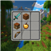

<p align="center">
  
</p>

<h1 align="center">No Background Dark</h1>

<p align="center">
  A clean Minecraft resource pack that removes GUI blur, dark overlays, and vignette effects.
</p>

<p align="center">
  <a href="README.id.md">Bahasa Indonesia</a>
</p>

<p align="center">
  <a href="https://github.com/fadhlanel/no-background-dark/releases/latest"></a>
  <a href="https://github.com/fadhlanel/no-background-dark/actions/workflows/release.yml"></a>
</p>

## Features

- Removes GUI background blur.
- Removes dark menu overlays.
- Removes the vignette effect.
- Keeps world visibility while menus are open.
- Client-side only. No server installation required.
- No additional performance impact.

## Installation

1. Download the `.zip` file from the [latest release](https://github.com/fadhlanel/no-background-dark/releases/latest).
2. Place the file in `.minecraft/resourcepacks/`.
3. Open **Options** → **Resource Packs** in Minecraft.
4. Enable **No Background Dark**, then click **Done**.

> Do not extract the downloaded `.zip` file.

## Compatibility

| Minecraft version | Status | Resource pack format |
| --- | --- | --- |
| 1.21.11+ | ✅ Supported | 70+ |
| 1.21.6–1.21.10 | ✅ Supported | 56–69 |
| 1.20.5+ | ✅ Compatible | 15+ |

Works with **Sodium**, **Iris**, and most optimization mods.

## How It Works

<details>
<summary>View technical details</summary>

This resource pack modifies Minecraft GUI shaders to:

- Set alpha to `0.0` for dark backgrounds.
- Replace blur post-processing with direct blit passes.
- Use a transparent vignette texture.

Main modified files:

- `assets/minecraft/shaders/core/gui.vsh`
- `assets/minecraft/shaders/core/rendertype_gui_overlay.vsh`
- `assets/minecraft/shaders/post/transparency.json`
- `assets/minecraft/textures/misc/vignette.png`

</details>

## Build from Source

```bash
git clone https://github.com/fadhlanel/no-background-dark.git
cd no-background-dark
zip -r NoBackgroundDark.zip assets/ 1.21.11/ 1.21.6-1.21.10/ pack.mcmeta pack.png
```

## Releases

GitHub automatically creates a release when a tag beginning with `v` is pushed.

```bash
git tag v1.0.0
git push origin v1.0.0
```

Each release includes a ready-to-use `NoBackgroundDark-v1.0.0.zip` file.

## License

Free to use and modify. Credit appreciated, but not required.

<p align="center">
  Made by <strong>nuel</strong> for players who prefer clean interfaces.
</p>
